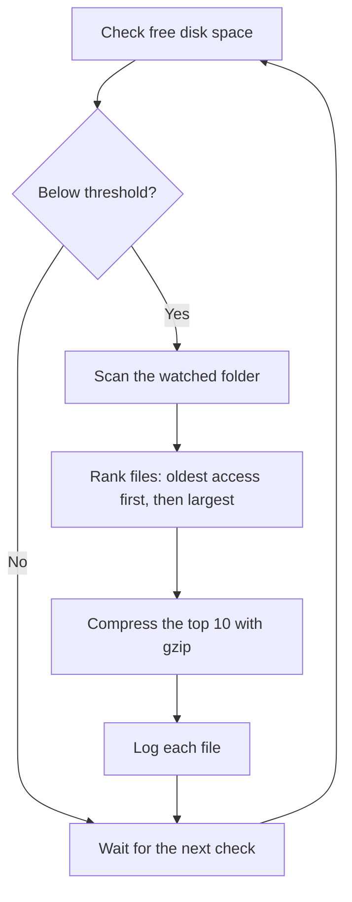

# SmartCompress FS

**Automatically compress your least-used files when disk space runs low.**

SmartCompress FS is a Python utility that watches your free disk space. When it
drops below a threshold you choose, it finds the files in a folder that you have
not opened for the longest time, prefers the larger ones, and compresses them
losslessly with gzip. Every byte can be restored.

It comes with two tools:

- **A command-line monitor** (`smartcompress.py`) that runs in the background
  and compresses files automatically.
- **A desktop app** (`fullmodule.py`) for compressing and restoring individual
  files by hand, with a live disk-usage bar.

## Features

- **Disk monitoring:** checks free space at a regular interval and acts only
  when it falls below your threshold.
- **Smart file selection:** ranks files by last-access time, then by size, so
  the coldest and largest files are compressed first.
- **Lossless compression:** gzip (and zlib in the desktop app). Restored files
  are byte-for-byte identical to the originals.
- **Safe restoration:** the desktop app records each file's original path and
  timestamps in a JSON file, restores them on decompression, and asks before
  overwriting an existing file.
- **Skips files that should not be touched:** already compressed files (`.gz`,
  `.zlib`) and system or temporary files (`.sys`, `.ini`, `.dll`, `.exe`,
  `.log`, `.tmp`) in the desktop app.
- **Logging:** the command-line monitor writes every compression and error to
  `smartcompress.log`; the desktop app shows the latest action in its status bar.

## How it works



## Requirements

- Python 3.8 or newer
- [`psutil`](https://pypi.org/project/psutil/) for reading disk usage
- Tkinter for the desktop app only. It ships with Python on Windows and macOS.
  On Ubuntu or Debian, install it with `sudo apt install python3-tk`.

Works on Linux, macOS and Windows.

## Installation

On Ubuntu and other Linux distributions, install the snap:

```bash
sudo snap install smartcompress
```

Or run it from source:

```bash
git clone https://github.com/archisha-g/smartcompress.git
cd smartcompress
pip install -r requirements.txt
```

## Usage

### Command-line monitor

```bash
python smartcompress.py --watch-dir ~/Downloads --threshold 15
```

This checks free space on the disk that holds `~/Downloads` every 60 seconds. When less than 15% is free, it
compresses up to 10 of the least recently used files in `~/Downloads`.

| Option | Default | What it does |
| --- | --- | --- |
| `--watch-dir` | (required) | Folder whose files may be compressed |
| `--threshold` | `10` | Start compressing when free space (%) drops below this |
| `--disk` | disk holding `--watch-dir` | Path on the disk to monitor |
| `--interval` | `60` | Seconds between checks |

Run `python smartcompress.py --help` to see all options. Stop it with `Ctrl+C`.

### Desktop app

```bash
python fullmodule.py
```

Use **Compress File** to pick a file and choose gzip or zlib, and
**Decompress File** to restore a file from the list.

## Restoring files

- **Compressed by the desktop app:** select the file in the app and click
  **Decompress File**. Its original name, location and timestamps come back.
- **Compressed by the command-line monitor:** each file is saved as
  `name.gz` next to where it was. Restore it with any gzip tool, for example
  `gunzip ~/Downloads/report.pdf.gz`.

> **Important:** the command-line monitor deletes each original after it has
> been compressed. Point `--watch-dir` only at a folder you are happy to have
> compressed, and try it on a test folder first.

## Project structure

| File | Purpose |
| --- | --- |
| `smartcompress.py` | Command-line disk monitor and automatic compressor |
| `fullmodule.py` | Tkinter desktop app for manual compression and restoration |
| `file_prioritizer.py` | File ranking and metadata helpers |
| `index.html` | Project website ([live demo](https://smartcompress-nine.vercel.app/)) |

## Roadmap

- Record metadata from the command-line monitor too, so its files can be
  restored from the desktop app
- Merge the tools into one installable package
- Package for Ubuntu as a snap

## License

Released under the [MIT License](LICENSE). Copyright (c) 2025 Archisha Ghanshani.
